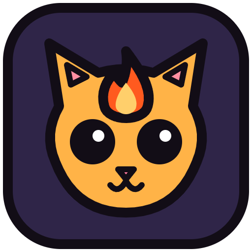

# Emberdeep

A real-time top-down roguelite with 100 floors and 10 bosses. It runs in the browser, and everything lives in one file.

Play it at https://slopathon.github.io/emberdeep/

Pick a class in the Hearth, walk to The Deep, and go. Nothing saves between runs. Only your settings, cosmetics and career stats stick around.

## Difficulty

The Deep is slow and hard on purpose. Fights are won by reading attacks and moving, not by standing still.

- Every foe type has one heavy attack that hits far harder than anything else it does, with a telegraph on the floor, a sound cue and a wind-up pose that changes its outline and holds for the whole telegraph.
- Some foes chase you down and some keep their distance. Their speeds vary more than 3x.
- Hits push you back. Hazards never do, and knockback never throws you into lava.
- Touching a miniboss or boss hurts at most once every 1.4 seconds, except the Hollow King.
- Lower health means slower movement, down to 78% of full speed, and your character looks hurt: a plaster under 60% health, bandages, a hunch and a limp under 35%. Getting hit makes your hero recoil away from the blow with a short pale flash.
- Levels need at least 1.5x more XP than before from level 5 on.
- You can hold at most 40 power cards in a run. Level ups past the cap turn into gold. Card hands are no longer for sale.
- Auto attack does full damage, but a hero who stands still dies on the first floor and an AFK hero never clears it.

## Classes

- Wizard, Controller: elements, zones and synergy chains
- Bow, Marksman: hold to draw, release in the sweet spot
- Rogue, Striker: build Edge up close and spend it before it fades
- Priest, Support: heals run on Faith, and Faith comes from landing hits. The Wide Grace card widens healing reach by 20% per rank, up to 5 ranks
- Knight, Vanguard: the shield only stops what you are facing, and a spent block takes 12 seconds to come back

## Animals

Pick an animal in the Looking Pool by the Hearth. It is free and you can switch at any time. Each one has one power on R, or the paw button on touch. Powers recharge on every new floor.

| Animal | Power | Effect | Cooldown |
|---|---|---|---|
| Cat | Nine Lives | 6s where you cannot drop below 1 health | 112.5s |
| Lion | Rage | 5s of 50% more damage, and you grow bigger | 60s |
| Bear | Thick Hide | 6s of taking 60% less damage while healing 20% of your health | 80s |
| Rabbit | Zoomies | 5s of 50% more speed with dashes refilling instantly | 60s |
| Fox | Vanish | 4s where regular foes lose track of you. Your next hit deals triple damage and ends it | 60s |
| Wolf | Howl | 6s of 30% faster attacks for you and allies within reach | 70s |
| Turtle | Shell | 3s of no damage with shots bounced back, but you cannot move or attack. Dash, blink or a skill ends it | 60s |

## Controls

- WASD: move
- Mouse: aim, hold to attack
- 1 2 3 4: skills
- Space: dash
- Right click or Shift: blink
- F: potion
- R: animal power
- T: auto attack
- Tab: gear and powers
- Q and E: zoom
- Esc: pause, run stats and your name (up to 12 characters)
- E: use things in the Hearth
- V: ping (in a party)

Touch controls work on phones too. HUD panels fade while a foe, shot or telegraph is behind them.

## Dungeons

Each zone is one connected dungeon of 9 generated rooms followed by its boss. Rooms come from 30 layout archetypes with mirroring, rotation, size jitter, alcoves and zone props, built from a run seed so every player in a party gets the same dungeon. Two or three forks per zone let you pick between two rooms on the same floor. The map in the top right shows the zone, the room you are in, the forks and the boss.

## Co-op

Up to 5 players. Ring the Rally Bell in the Hearth to host a party or join one with a 5 letter code or a share link. Everyone walks around the Hearth together, picks a class at the stumps and readies up at The Deep. The run starts when everyone is ready. Nothing saves and everyone starts at level 1.

- The host's game runs the world. Everyone else sends inputs and sees the host's world at 15 snapshots a second, with their own movement predicted locally.
- Gold, gear, gems, potions and chests are instanced. Every player gets the full value of every drop for their own class and only sees their own loot. XP and level are shared.
- Power and gem picks happen at the door after a clear. The door waits until everyone has picked, or 20 seconds.
- Foe and boss health scale with party size. A party of one plays exactly like solo.
- Roles: Wizard hits mark foes as controlled, Rogue deals more to controlled, stunned or chilled foes, Bow sweet spot hits mark a foe so the whole party deals more to it, Priest heals reach nearby allies, Knight draws foes and its raised shield stops shots aimed at allies behind it.
- Animal powers run on the host. Howl reaches allies close by, and foes look past a vanished fox to the next player.
- A downed player is revived by an ally standing close for 3 seconds, or returns at the next room. The run ends when everyone is down.
- If someone drops they have 5 seconds before their character leaves, and they can rejoin with the same code. If the host drops, the next player takes over and the room restarts from the last checkpoint.
- The Trial Stone stays solo.
- Duels: the host turns Duel on in the party panel and splits players into two teams. Party members then fight each other in an arena with no boss. The host runs the duel, priests only heal their own team, and only a teammate can revive you.
- Party stats sync to everyone during the run and show on the end screen for the whole party.

## Stats

The end of every run shows its stats, and the pause menu has a stats tab for the run in progress. Career stats add up across runs in their own `emberdeep-career` key in local storage, and open from the Hearth settings. Runs themselves still never save, the dummy yard and duels do not count as runs, and there is no server database.

## Sound

Sounds come from two files beside `index.html`: `sfx.mp3` holds every sound effect and `amb.mp3` holds the ambience loops. Both load after your first click or key press.

- Every sound picks a random take and pitch, so a sword swing has 3 samples at 3 pitches.
- Sounds pan toward where they happen and get quieter far from the camera.
- Each foe type has its own attack and death sounds, each boss has its own voice, and big attacks add layers and reverb.
- Every zone and the Hearth have their own ambience. The Ambience slider in the settings sets its volume.
- At most 12 sounds play at once. Routine sounds are quiet and throttled, so getting hurt is the loudest sound in the game and still plays when every voice is busy.
- Foe attacks sound a rising cue when their telegraph appears, and boss telegraphs add a deeper layer.
- Until the files load, or if they fail, the old synth sounds play.

## Relay

Co-op needs a small relay because GitHub Pages only serves static files. The relay is a Cloudflare Worker with one Durable Object per party in `server/`. It only forwards messages between players, caps parties at 5, caps message size, rate limits each connection, only accepts the allowed origins, closes idle parties and stores nothing.

Deploy it:

```bash
cd server
npx wrangler login
npx wrangler deploy
```

Then put the `wss://` address it prints into the `RELAY` constant near the top of the script in `index.html`, for example `const RELAY='wss://emberrelay.example.com'`. The live game uses `wss://emberrelay.pawfectaddons.net`. Without a relay the game plays solo and the Rally Bell says multiplayer is not set up. For testing you can also add `?relay=wss://...` to the page address.

Everyone in the Hearth shares one public channel on the relay (`/lobby`, up to 30 players), so players see each other walking around without being in a party. It sends position, name, class and cosmetics, and disconnects during runs or when the tab is hidden. Hosted parties are listed on the Rally Bell, and hosts can remove players. Players can opt out with "Hide me from the Hearth" in the Still Lantern settings, which also hides their party from the list.

## Dummy yard

A test area for the planned items, behind the Hooded Stranger in the Hearth. It has 75 items (15 per class), a damage meter, and dummies for single target, area, chaining, piercing, moving, armored, on kill, status, execute and incoming damage testing. Items only exist in the yard for now and are not balanced. The password check is only there to keep players out by accident, so it sits in the page source.

## Tests

```bash
cd tests
node run.mjs
```

This needs Node 20 or newer and Playwright with Chromium (`npm i playwright` then `npx playwright install chromium`). It runs everything in `tests/`: static checks, 200 seeds of generated rooms, solo regression, AFK checks, the relay, 5 player co-op through a local relay with and without added latency, failure cases, every animal power, auto attack range, sound loading and mixing, every item of tester feedback, the art, phone layouts and performance. Run a single suite with `node run.mjs rooms`. Set `WRANGLER` to a wrangler binary to also test the real worker locally. Run the rooms suite on its own, because the solo suite has timing checks.

### Balance

`tests/balance/` measures balance with bots of low, mid and high skill, plus auto attack only, standing still and AFK. Bots show relative numbers, so they can't prove a fight feels fair. A full pass takes hours, so it is not part of `node run.mjs`.

- `node balance/matrix.mjs` reads what to test from the game's own tables (classes, items, powers, animals, foes, minibosses, zone foes, bosses and shops) and fails if any entry has no result. Its sections are `cap`, `zone`, `boss`, `entry`, `mb`, `elite`, `fw`, `heal`, `duel`, `builds`, `rush` and `party`. Pick some with `--sec=zone,boss`, set parallel browsers with `--par=10`, test another copy of the game with `--file=`, and rebuild `balance/coverage.md` from saved results with `--report`. The coverage file lists every entry and how it was tested.
- `node balance/pacing.mjs` plays whole runs and records floor clear times, levels per floor, boss fight length and the first death, so a build can be compared to a baseline with `--file=`.
- `node balance/duel.mjs` plays duel matchups. `node balance/spiral.mjs` checks that the low health slow and knockback don't cause death spirals or push heroes into hazards.
- Results go to `balance/out/`, which git ignores.

## Editing

There is no build step. Change `index.html` and refresh the page. Fonts load from Google Fonts, and the whole game is in that file. The icons, share image, web manifest and the two sound files sit beside it.

## Credits

All art is original. Heroes, animals, foes, bosses, effects, rooms, the Hearth and the UI icons are drawn by code in `index.html` with ink outlines and flat color, and cached as images while the game runs.

Sound effects are under CC0. A few, like the wizard bolt, wind and the campfire, are synthesized. The rest come from:

- [Impact Sounds](https://kenney.nl/assets/impact-sounds), [Interface Sounds](https://kenney.nl/assets/interface-sounds), [RPG Audio](https://kenney.nl/assets/rpg-audio), [Sci-Fi Sounds](https://kenney.nl/assets/sci-fi-sounds) and [Digital Audio](https://kenney.nl/assets/digital-audio) by Kenney
- [100 CC0 SFX](https://opengameart.org/content/100-cc0-sfx), [100 CC0 SFX #2](https://opengameart.org/content/100-cc0-sfx-2), [25 CC0 bang / firework SFX](https://opengameart.org/content/25-cc0-bang-firework-sfx), [40 CC0 water / splash / slime SFX](https://opengameart.org/content/40-cc0-water-splash-slime-sfx), [75 CC0 breaking / falling / hit sfx](https://opengameart.org/content/75-cc0-breaking-falling-hit-sfx), [80 CC0 creature SFX](https://opengameart.org/content/80-cc0-creature-sfx) and [80 CC0 RPG SFX](https://opengameart.org/content/80-cc0-rpg-sfx) by rubberduck on OpenGameArt
- [RPG Sound Pack](https://opengameart.org/content/rpg-sound-pack) by artisticdude on OpenGameArt
- [Bow Release (Bow and Arrow) 4](https://freesound.org/s/384917/) by Ali_6868 on Freesound
